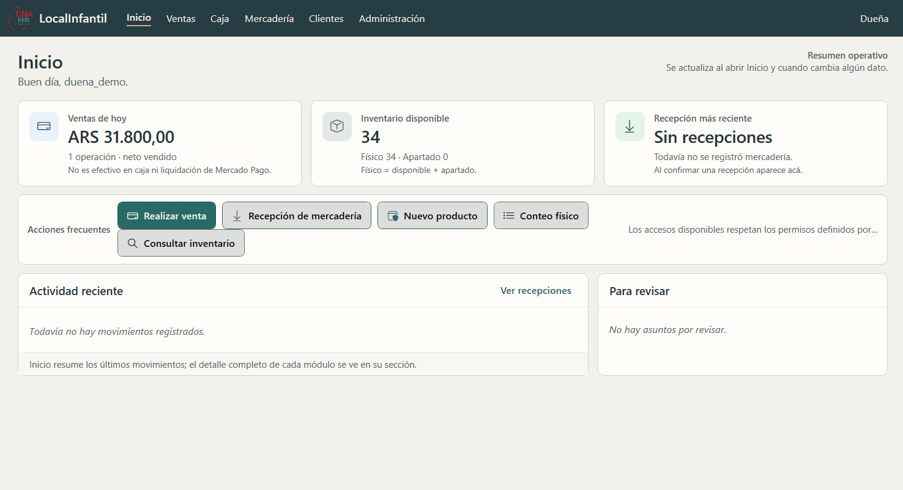
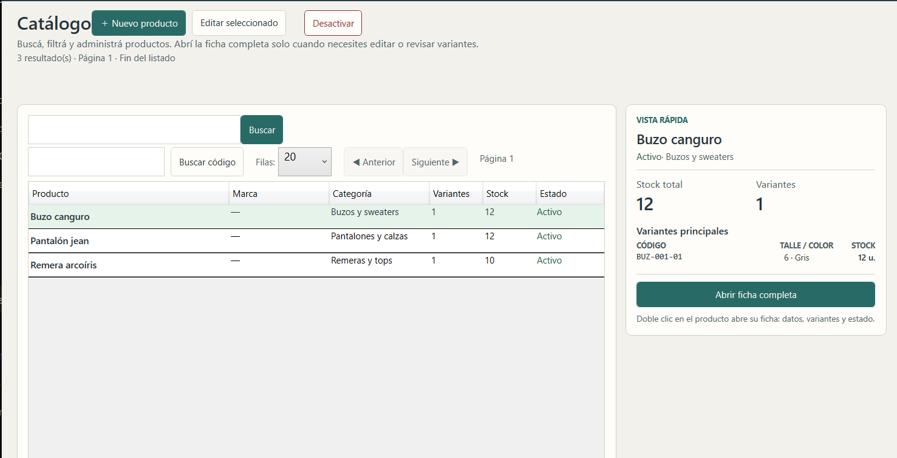
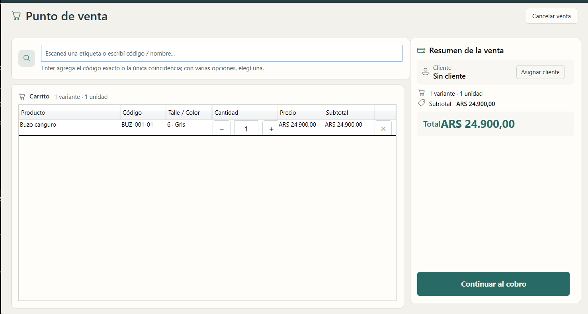

# LocalInfantil

Estructura inicial para una aplicación de escritorio de un único local de ropa infantil. El alcance actual incluye la publicación de prueba de **F00-T06**: navegación de demostración, comprobación mínima de SQLite, prototipo de impresión y una carpeta self-contained para el equipo de desarrollo. No contiene flujos comerciales ni datos reales del comercio.

## 📸 Capturas de la versión avanzada

> **Importante:** las imágenes corresponden a la versión más avanzada en desarrollo de LocalInfantil (rama `feat/f12-mercado-pago`). La rama `main` documenta un prototipo anterior. No representan las funciones de `main` ni una instalación validada en el comercio.

### Inicio y resumen


### Catálogo de productos


### Punto de venta


Capturas con datos de demostración. Mercado Pago Point no fue verificado con hardware real.

## Requisitos provisionales

- Windows para compilar y ejecutar el proyecto WPF.
- SDK de .NET 10.0.x compatible con `net10.0`.

Los proyectos usan `net10.0` / `net10.0-windows` como migración controlada y verificada en el equipo de desarrollo. .NET 10 es LTS hasta noviembre de 2028. Esto no aprueba su instalación en el local: la edición, versión y arquitectura del Windows real siguen pendientes en F00-T02. Ver [DECISIONES.md](docs/DECISIONES.md).

## Estructura

- `src/LocalInfantil.Domain`: reglas y tipos puros, sin dependencias de UI ni SQLite.
- `src/LocalInfantil.Application`: casos de uso; depende de Domain.
- `src/LocalInfantil.Infrastructure`: adaptador SQLite de la comprobación técnica e I/O futuro; depende de Application y Domain.
- `src/LocalInfantil.Wpf`: único ejecutable WPF; depende de Application e Infrastructure.
- `tests/LocalInfantil.Tests`: pruebas de Domain y de la navegación WPF del prototipo.

La ventana principal ofrece Inicio y Estado del prototipo mediante MVVM simple. En Estado se puede ejecutar una comprobación técnica SQLite y abrir una vista previa de impresión con datos ficticios. Solo desde esa vista se abre el diálogo nativo para seleccionar y confirmar una impresora; no se imprime automáticamente. No realiza operaciones comerciales ni conexiones a red.

La base SQLite, sus archivos WAL/SHM, respaldos, logs y secretos se mantienen fuera del repositorio. Solo para el prototipo, la ruta predeterminada es `%LOCALAPPDATA%\LocalInfantil\Prototype\localinfantil-prototype.db`; no es una decisión de producción. La ruta definitiva de datos depende de D-13 y se resolverá antes de guardar datos reales.

## Comandos

Desde la raíz de la solución:

```powershell
dotnet restore LocalInfantil.sln
dotnet build LocalInfantil.sln --configuration Debug
dotnet test LocalInfantil.sln --configuration Debug --no-build
```

## Publicación de prueba

La publicación .NET 10 actual es una carpeta self-contained de prueba para la arquitectura confirmada del equipo de desarrollo (`win-x64`). No es un instalador ni valida la arquitectura de la PC del local. La publicación .NET 8 anterior permanece separada en `artifacts\publish\win-x64`.

```powershell
dotnet restore LocalInfantil.sln --runtime win-x64
dotnet publish src\LocalInfantil.Wpf\LocalInfantil.Wpf.csproj --configuration Release --runtime win-x64 --self-contained true --no-restore --output artifacts\publish\net10-win-x64 --disable-build-servers -m:1 -p:DebugType=None -p:DebugSymbols=false
.\artifacts\publish\net10-win-x64\LocalInfantil.Wpf.exe
```

La carpeta publicada se puede eliminar sin borrar datos de usuario porque la comprobación SQLite usa `%LOCALAPPDATA%\LocalInfantil\Prototype\`, fuera de `artifacts\publish`. Para borrar solo la publicación de prueba:

```powershell
Remove-Item -LiteralPath .\artifacts\publish\net10-win-x64 -Recurse
```

## Instalador de prueba (F00-T06, Inno Setup 6)

El instalador de prueba se genera con Inno Setup 6 a partir de la publicación anterior. Solo están versionados `installer/inno/LocalInfantil-Prototype.iss` y `installer/Build-PrototypeInstaller.ps1`; el Setup generado queda en `artifacts/installer/` (fuera de git). Instala por usuario (sin admin) en `%LOCALAPPDATA%\Programs\LocalInfantil-Prototype`, crea acceso directo en el menú Inicio y se desinstala desde Configuración > Aplicaciones instaladas sin tocar `%LOCALAPPDATA%\LocalInfantil` (D-13 sigue pendiente; la ruta SQLite provisional no cambia). Requiere tener instalado Inno Setup 6 (`ISCC.exe`). No incluye actualizaciones automáticas ni afirma compatibilidad con la PC del local.

```powershell
powershell -ExecutionPolicy Bypass -File .\installer\Build-PrototypeInstaller.ps1
```

El procedimiento de prueba manual con datos ficticios aislados está en `docs/PRUEBAS_MANUALES.md`. No ejecutar instalación/desinstalación sin leerlo: protege la base provisional existente.

## Convenciones

- Código y documentación en español cuando describan el negocio; nombres de tipos y APIs de .NET se mantienen claros y consistentes.
- `Nullable` e `ImplicitUsings` están habilitados en todos los proyectos.
- Las dependencias siguen el sentido indicado en `ESTRUCTURA.md`; WPF nunca accede a SQLite directamente.
- El único paquete de SQLite incorporado para F00-T04 es `Microsoft.Data.Sqlite` 10.0.12; no se utiliza Entity Framework ni otro ORM.

## Estado

Consultar `PLAN.md` para la planificación y `docs/DECISIONES.md` para decisiones pendientes. F00-T02 queda bloqueada hasta validar la PC del local; F00-T06 sigue en curso: el instalador de prueba ya se genera y fue validado manualmente en una cuenta local estándar independiente, y resta la validación en ese equipo.
