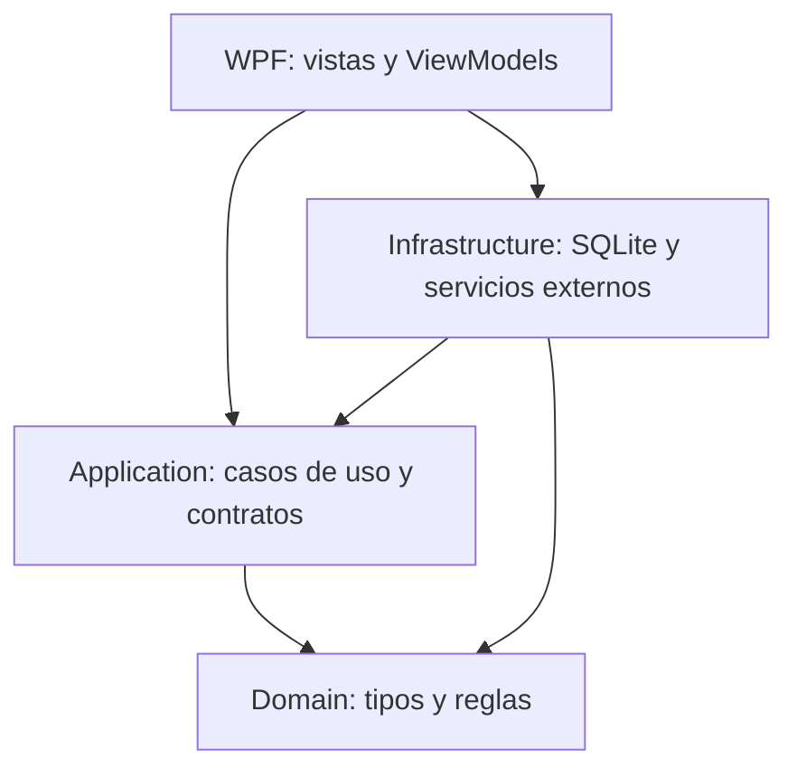

# LocalInfantil — Sistema de Gestión Comercial

   

Aplicación de escritorio para Windows destinada a administrar las operaciones comerciales de un local de ropa infantil. Integra catálogo, existencias, ventas, clientes y caja.

Forma parte del portafolio académico y profesional de **Matías Borsini**, estudiante de Desarrollo de Software. Está en desarrollo y **no está habilitada para producción ni para datos comerciales reales**.

## Funcionalidades

- **Productos:** categorías, variantes por talle y color, códigos internos y precios.
- **Inventario:** carga inicial, recepción de mercadería, movimientos, stock apartado y conteo físico.
- **Ventas:** búsqueda y carrito, pagos simples o combinados, confirmación transaccional y anulación total auditada.
- **Clientes y cuenta corriente:** fichas, límites explícitos de crédito, ventas a cuenta, cargos y abonos.
- **Caja:** apertura, movimientos, arqueo, cierre y conciliación por medio de cobro.
- **Cambios y devoluciones:** prendas devueltas, artículos nuevos y liquidación de diferencias. La promoción de F06-T05 sigue bloqueada.
- **Reportes:** consultas de ventas, caja e inventario. Costos y márgenes definitivos siguen pendientes de definición.
- **Comprobantes e impresión:** comprobantes internos no fiscales, vista previa y diálogo de impresión de Windows.
- **Usuarios:** autenticación local, roles, permisos individuales y auditoría.
- **Respaldos:** copias locales protegidas y preparación de respaldos remotos; Google Drive real sigue pendiente de validación.

## Mercado Pago Point

El módulo vincula el cobro de una venta con una terminal Point mediante HTTP y JSON, sin SDK de Mercado Pago. Descubre terminales, crea y consulta órdenes, gestiona cancelaciones y reembolsos, y conserva identificadores para reconciliar resultados inciertos. También contempla registro manual y conciliación mediante importación de liquidaciones.

La integración **no fue validada con una terminal y cuenta de producción**. La descarga automática de liquidaciones por API está diseñada, pero no implementada. No hay webhooks en esta aplicación de escritorio. Ver [Mercado Pago](docs/MERCADO_PAGO.md).

## Tecnologías y arquitectura

C#, .NET 10, WPF y XAML, SQLite mediante `Microsoft.Data.Sqlite`, xUnit, ZXing.Net para códigos de barras y Sodium.Core para operaciones criptográficas. Los secretos locales de Windows utilizan DPAPI.



Los repositorios concretos y servicios se conectan en WPF; las reglas de aplicación y autorización están separadas de las vistas. Ver [ESTRUCTURA.md](ESTRUCTURA.md) y [DECISIONES.md](docs/DECISIONES.md).

```text
LocalInfantil.sln
src/
  LocalInfantil.Domain/          Dominio
  LocalInfantil.Application/     Casos de uso y contratos
  LocalInfantil.Infrastructure/  SQLite, migraciones e integraciones
  LocalInfantil.Wpf/             Aplicación de escritorio
tests/LocalInfantil.Tests/       Pruebas automatizadas
docs/                            Decisiones y guías
installer/                       Instalador de prueba
```

## Compilación y ejecución

Se necesita Windows y el SDK de .NET 10. Desde la raíz:

```powershell
dotnet restore LocalInfantil.sln
dotnet build LocalInfantil.sln --configuration Debug
$env:LOCALINFANTIL_MP_TEST_ACCESS_TOKEN = ''
dotnet test LocalInfantil.sln --configuration Debug --no-build
```

Las pruebas abarcan casos de uso, transacciones, persistencia, permisos y componentes WPF. Algunas requieren una sesión gráfica de Windows. La variable vacía impide que la prueba live de Point contacte el servicio desde esa consola; esa prueba solo debe ejecutarse en un entorno autorizado y no es necesaria para la demostración.

Para iniciar con una base ficticia **nueva y aislada**, elegí una ruta que no corresponda a una base existente:

```powershell
dotnet run --project src/LocalInfantil.Wpf/LocalInfantil.Wpf.csproj --configuration Debug -- --dev-db "C:\ruta-de-prueba\demo-localinfantil.db"
```

La carpeta de destino debe existir. La aplicación prepara el esquema y solicita configurar la primera usuaria según el flujo de inicio. No guardes credenciales de demostración en el repositorio. El comando de inicio debe comprobarse en el equipo de presentación.

## Demostración y capturas

El recorrido de 90 segundos y los cuidados para preparar datos ficticios están en [DEMO_COLOQUIO.md](docs/DEMO_COLOQUIO.md).

### Inicio y resumen


### Catálogo de productos


### Punto de venta


Las capturas usan datos de demostración y no acreditan una instalación validada en el comercio. La prueba de Mercado Pago Point con hardware real sigue pendiente.

## Estado y limitaciones

El catálogo de migraciones del código llega a **V19**: V16 incorpora persistencia Point, V17 cobro manual, V18 liquidaciones y V19 identidad de filas. Las migraciones no almacenan credenciales.

Siguen pendientes la prueba de Point con cuenta y terminal reales, OAuth/Drive real, la validación en la computadora e impresora definitivas y la definición del procedimiento fiscal. Los comprobantes son internos, no facturas. El instalador y las actualizaciones requieren validaciones adicionales; ver [PLAN.md](PLAN.md), [pruebas manuales](docs/PRUEBAS_MANUALES.md) y [guía de uso](docs/GUIA_USO.md).
